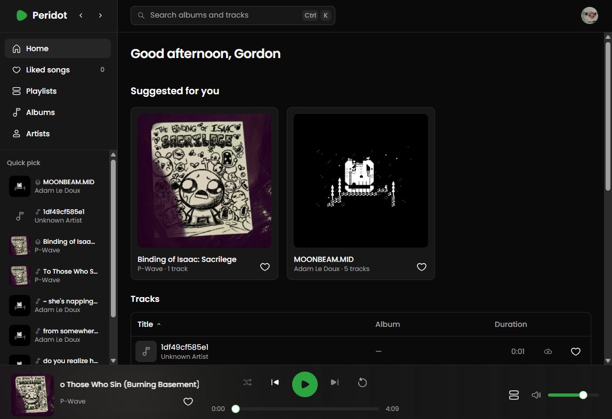

<p align="center">
  
</p>

<h3 align="center">Your self-hosted music platform</h2>


  **Peridot is a self-hosted music platform, giving you total control over your
  music library.
  No ads, no paywall. You have control.**




## Install with Docker

1. **Create a Compose file**

   Save this as `compose.yaml` and create the local folders. Change the music
   path to include your library. The default `stable` image is the production
   channel.

   ```yaml
   services:
     peridot:
       image: ghcr.io/ciriak/peridot:${PERIDOT_CHANNEL:-stable}
       restart: unless-stopped
       ports:
         - "${PERIDOT_API_PORT:-17430}:17430"
         - "${PERIDOT_WEB_PORT:-17431}:17431"
       volumes:
         - ./data:/data
         - ./music:/music:ro

     watchtower:
       image: nickfedor/watchtower:1.24.0
       restart: unless-stopped
       command: >-
         --label-enable
         --http-api-endpoints update
         --http-api-periodic-polls
         --cleanup
         --interval 21600
       depends_on:
         peridot:
           condition: service_healthy
       environment:
         WATCHTOWER_HTTP_API_TOKEN: /data/watchtower-token
       volumes:
         - ./data:/data:ro
         - /var/run/docker.sock:/var/run/docker.sock
   ```

   ```sh
   mkdir -p data music
   ```

2. **Start it**

   Run this from the folder with your Compose file.

   ```sh
   docker compose up -d
   ```

3. **Open Peridot**

   Go to **http://YOUR_SERVER_IP:17431** in your browser.

## Features

- ### 🗂️ Local-first catalog
- ### 🛜 Offline play
- ### 🧩 Automatic metadata association


## 🚀 Coming soon

- ### 🔄 Playlists import
- ### ✨ AI suggestion *(But only if you want it !)*
